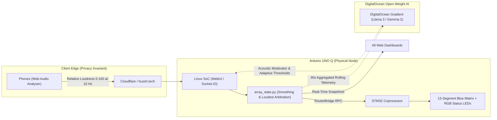

# Hush

A distributed sound-awareness dashboard and microphone array built for the **Arduino UNO Q**. Open the secure webpage on several phones, name each microphone, and let the loudest active location drive the board's blue LED meter and RGB warnings.

Built for the [MLH Hacktoberfest Hack Day Portland × Portland AI Community](https://www.mlh.com/events/hacktoberfest-hack-day-portland-x-portland-ai-community) by **Team Hush** (Elijah Lynn, Brian, Joshua [Logo Designer], & Phil Gear).

Audio never leaves the phones. The server receives relative loudness readings (0–100 at 10 Hz), not audio recordings.

---

## What Works

- **Distributed Microphone Array**: Multiple named phone microphones plus read-only viewers.
- **Privacy-Preserving Loudness Arbitration**: Quiet clients cannot overwrite louder clients; audio stays on-device.
- **Per-Device Calibration**: Sensitivity slider (-35 to +40 dB) and automatic baseline noise calibration.
- **Visual Feedback**:
  - Live 13-segment blue matrix VU meter with peak hold and separate green/yellow/red RGB status LEDs.
  - A four-second **HUSH** warning when thresholds are breached, followed by at least three seconds of meter recovery.
  - 30-second bar-history sparklines for the entire room and individual stations.
- **Accessible & Responsive UX/UI**:
  - Full WCAG accessibility: semantic ARIA meter, polite status announcements, assertive HUSH alerts, and keyboard skip-links.
  - Joshua's matrix logo integrated into a responsive squircle with vibrant electric feedback.
- **Zero-Hardware Browser Simulator**: `assets/preview.html` allows immediate testing of the multi-source array logic in any browser without needing physical hardware connected.
- **Automated Infrastructure & Custom Domain**:
  - Autonomous power-bank boot via systemd.
  - Secure Cloudflare Tunneling (`cloudflared`) and Porkbun DNS automation (`scripts/porkbun-dns.py`) routing `hussh.tech` $\to$ active demo.
  - Wireless deployment and remote diagnostics over SSH.

---

## Architecture & DigitalOcean Open-Source AI



### Real-Time Physical VU + Open-Source AI Co-Processing
1. **Zero-Latency Physical Metering**: The STM32 microcontroller continuously drives the 13-segment blue LED matrix and RGB status LEDs at a tight 25 Hz loop (`sketch.ino`), providing immediate visual cues to everyone in the room.
2. **DigitalOcean Open-Weight Acoustic AI**: While raw audio never leaves phones, 30-second rolling noise profiles (RMS variance, frequency of spikes, station counts) are evaluated by an open-weight model hosted on [DigitalOcean Gradient](http://mlh.link/digitalocean). The AI calculates room acoustic fatigue and adapts the dynamic HUSH alert thresholds to prevent alert fatigue in large or bustling spaces.

---

## Hardware & System Requirements

- **Arduino UNO Q**, tested with the 4 GB model (other Uno models are not supported by this sketch).
- **USB-C Power**: 5 V / 3 A power bank or wall adapter.
- **Phones**: Any modern mobile browser with Web Audio API support (`getUserMedia`).
- **Software Tested**:
  - Arduino App CLI **0.6.6**
  - Arduino Zephyr core **0.51.0**
  - Python-apps base **0.5.0**
  - `cloudflared` **2026.10.7** (ARM64)
- **Host Development Prerequisites**: Python 3.10+, Node.js, and optionally a C++17 compiler.

---

## 1. Local Development & Pre-Flight Checks

Before deploying or committing, run the cross-platform test suite to verify arbitration logic, security guards, CSP compliance, and shell syntax:

- **Windows PowerShell**:
  ```powershell
  pwsh ./scripts/check.ps1
  ```
- **POSIX / Linux / macOS**:
  ```sh
  ./scripts/check.sh
  ```

### Interactive Web Simulator
To test the sound awareness UI without an Arduino board connected:
```sh
python -m http.server 8765 --directory assets --bind 127.0.0.1
```
Open **[http://localhost:8765/preview.html](http://localhost:8765/preview.html)** to test your microphone and simulate multi-source room noise.

---

## 2. Arduino UNO Q Board Setup

1. Follow the official [UNO Q setup guide](https://docs.arduino.cc/tutorials/uno-q/user-manual/) to configure Wi-Fi and the Linux user account (`arduino`).
2. Enable SSH/network mode using [Arduino's SSH instructions](https://docs.arduino.cc/tutorials/uno-q/ssh/). Configure key-based authentication from your workstation:

```sshconfig
Host hush-board
    HostName YOUR_BOARD_IP
    User arduino
    IdentityFile ~/.ssh/your_board_key
    IdentitiesOnly yes
```

Verify connectivity:
```sh
ssh hush-board 'hostname; arduino-app-cli version; docker info >/dev/null'
```

> **Note**: Deployment scripts target `/home/arduino/ArduinoApps/phone-vu`. The `phone-vu` directory and service names are legacy deployment identifiers retained for hardware compatibility.

---

## 3. Deployment Modes

Use `./scripts/deploy.sh` to push updates over Wi-Fi without interrupting unnecessary board subsystems:

| Mode | Command | Impact |
| :--- | :--- | :--- |
| **UI Only** | `./scripts/deploy.sh hush-board --ui-only` | Zero downtime; updates `assets/` in place. Refresh browser. |
| **Server + UI** | `./scripts/deploy.sh hush-board --server-only` | Restarts `phone-vu-main-1` container; preserves active tunnel. |
| **Full (MCU + App)** | `./scripts/deploy.sh hush-board` | Uploads sketch, app, and assets; recompiles & resets STM32 MCU. |

---

## 4. HTTPS Tunnel & Domain Routing (`hussh.tech`)

Because browsers require HTTPS to access mobile microphones, the UNO Q establishes a secure tunnel on startup.

### Quick Tunnel with Porkbun Automation (`scripts/porkbun-dns.py`)
1. Add Porkbun credentials (`PORKBUN_API_KEY`, `PORKBUN_SECRET_KEY`) to `~/.env`.
2. Sync the board's active tunnel URL to `hussh.tech`:
   ```sh
   python scripts/porkbun-dns.py sync-board --host hush-board
   ```
   Now `https://hussh.tech` forwards phones directly to the live session.

### Permanent Named Tunnel (Production)
Set `CLOUDFLARE_TUNNEL_TOKEN` in `/home/arduino/.env` on the board. The startup service automatically runs the named tunnel and routes directly to `live.hussh.tech`.

---

## 5. Startup Services & Power-Bank Operation

Install the systemd services on the UNO Q:
```sh
ssh hush-board 'sudo /home/arduino/ArduinoApps/phone-vu/startup/install.sh'
```

| Service | Responsibility |
| :--- | :--- |
| `phone-vu-app` | Waits for Docker/RouterBridge, starts app, resets STM32 MCU, and auto-restarts on failure. |
| `phone-vu-tunnel` | Runs `cloudflared`, verifies local health, publishes `demo-url.txt`, and syncs domain forwards. |

When running on a 5 V / 3 A USB-C power bank, allow roughly **60–90 seconds** after power-on for Wi-Fi association, container launch, and tunnel stabilization.

---

## 6. Data & Timing Specifications

- **Loudness Updates**: 0–100 relative values transmitted at ~10 Hz over Socket.IO.
- **Smoothing**: Independent exponential smoothing per connection ($\tau = 120\text{ ms}$).
- **Expiry**: Client sources expire after 2.0s of silence; inactive names expire after 300s.
- **Client Capacity**: Guarded against runaway connections (`max_clients = 64`).
- **MCU Thresholds**:
  - Quiet: `< 45` (Green LED)
  - Moderate: `45–74` (Amber / Yellow LED)
  - Loud / HUSH Alert: `≥ 75` (Red LED + full matrix HUSH banner for 4s)

---

## MLH Sponsor Track: Best Open-Source AI Project (DigitalOcean)

Huush targets the **Best Open-Source AI Project** prize category:
- **Open-Weight AI Component**: Integrated with open-weight models (Llama 3 / Gemma 2) on [DigitalOcean](http://mlh.link/digitalocean) to provide contextual, non-punitive acoustic moderation without transmitting private voice data.
- **Hardware Integration**: The physical Arduino UNO Q LED matrix acts as the real-time feedback surface, bridged seamlessly between edge devices and cloud-hosted open-weight intelligence.

---

## Troubleshooting

| Symptom | Diagnostic & Recovery |
| :--- | :--- |
| **Microphone blocked on mobile** | Ensure you are accessing via `https://` (browser restricts audio on plain `http://`). |
| **Matrix frozen or set_level timeout** | Reset STM32 coprocessor: `ssh hush-board '/opt/openocd/bin/arduino-reset.sh'`. |
| **Board offline after power cycle** | Allow 90 seconds for DHCP/Wi-Fi. Verify SSH: `ssh hush-board 'systemctl status phone-vu-tunnel'`. |
| **Tunnel link changed** | If not using `hussh.tech`, visit the board's local Wi-Fi IP `/reconnect.html` to find the active URL. |
| **Compile missing MsgPack.h** | Ensure `sketch/sketch.yaml` is deployed with the sketch; it declares library dependencies. |

---

## Repository Map

```text
assets/                  Web dashboard, reconnect page, web simulator, and logo assets
docs/                    Color palette and design guidelines
python/array_state.py    Loudest-source arbitration, smoothing, and client expiry
python/main.py           Socket.IO WebUI handlers and STM32 RouterBridge control loop
scripts/                 Cross-platform check scripts (check.ps1, check.sh), Porkbun DNS, deploy
sketch/                  STM32 firmware (sketch.ino, sketch.yaml) driving LED matrix & RGB LEDs
startup/                 Systemd services, tunnel runners, and board installer
tests/                   Python arbitration tests, security guards, and C++ firmware simulation
```

---

## Presentation & Media

- **Presentation & Event**:
  - **MLH Hack Day Event**: [Hacktoberfest Hack Day Portland × Portland AI Community](https://www.mlh.com/events/hacktoberfest-hack-day-portland-x-portland-ai-community)
  - **Slide Deck**: [Hush Presentation Slides](https://docs.google.com/presentation/d/1jP3CuTykp_4LUVrt76FiEEfXdFVJt3TnR8M8GVah5TA/edit?slide=id.p10)
- **Live Simulator**: [hussh.tech](https://hussh.tech)
- **Board Target**: `live.hussh.tech`
