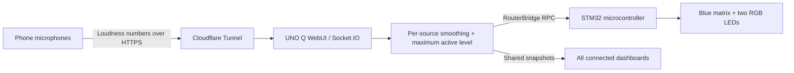

# Hush

A shared sound-awareness dashboard for the Arduino UNO Q. Open the same secure webpage on several phones, name each microphone, and let the loudest active location drive the board's blue LED meter and RGB warnings.

Audio stays on the phones. The server receives relative loudness readings, not recordings.

## What works

- Multiple named microphones plus read-only viewers.
- Loudest-active-source arbitration; quiet clients cannot overwrite louder clients.
- Per-phone sensitivity and background-baseline adjustment.
- Room and individual 30-second bar-history sparklines.
- Responsive meters at approximately 10 Hz, steadier numeric readouts at 4 Hz, and lightweight history charts at 4 Hz.
- Blue matrix VU meter, peak hold, and separate green/yellow/red RGB LEDs.
- A four-second **HUSH** warning, followed by at least three seconds of VU display before another warning.
- Automatic startup from a power bank and a local reconnect page for changing HTTPS links.
- Wireless development over SSH/SFTP.

The warm ivory, sage, lavender, amber, and berry palette is defined in `assets/hush.css`. The app uses a text heading; logo artwork is being handled separately.

## Architecture



This is a distributed set of sound sensors, not a phase-synchronized microphone array or a calibrated sound-level meter.

## Hardware and software

- Arduino **UNO Q**, tested with the 4 GB model. Other Uno models are not supported by this sketch.
- USB-C source rated **5 V / 3 A**; a suitable power bank works.
- One computer for initial setup and development, plus phones with browser microphone support.
- Computer and board on the same Wi-Fi network for SSH and the local reconnect page. Internet is needed for the HTTPS tunnel.
- Arduino App Lab / UNO Q system image with `arduino-app-cli`, Docker, RouterBridge, and the `arduino:web_ui` brick.

Tested device versions: Arduino App CLI **0.6.6**, Arduino Zephyr core **0.51.0**, Python-apps base **0.5.0**, and cloudflared **2026.10.7** on ARM64. The sketch profile pins the four required libraries. Newer board images may require validation; a system-image update is not part of these scripts.

Development checks require Python 3, Node.js, and a C++17 compiler. They do not require an Arduino connected.

## 1. Set up the board

Follow the official [UNO Q setup guide](https://docs.arduino.cc/tutorials/uno-q/user-manual/) to configure Wi-Fi and the board's Linux account. Complete the initial password setup; a factory account requiring a password change can block cron and noninteractive SSH.

Enable SSH/network mode using [Arduino's SSH instructions](https://docs.arduino.cc/tutorials/uno-q/ssh/). Configure key-based access from your computer. Verify the board host-key fingerprint through USB or its local console before trusting the first network connection. Keep private keys out of this repository.

Example local SSH configuration:

```sshconfig
Host hush-board
    HostName YOUR_BOARD_IP
    User arduino
    IdentityFile ~/.ssh/your_board_key
    IdentitiesOnly yes
```

Verify:

```sh
ssh hush-board 'hostname; arduino-app-cli version; docker info >/dev/null'
```

The deploy/startup scripts target the default `arduino` account and `/home/arduino/ArduinoApps/phone-vu`. **The `phone-vu` folder and service names are legacy deployment identifiers**, retained to match the tested device. The product name is Hush. Update all paths together if you rename the deployment directory.

## 2. Clone and deploy

On your development computer:

```sh
gh repo clone ElijahLynn/hush
cd hush
./scripts/check.sh
./scripts/deploy.sh hush-board
```

A full deployment transfers the app, compiles/uploads the sketch, starts Python, and resets the MCU. It briefly interrupts the demo. The `TMPDIR=/tmp` setting is intentional: ADB sessions on this image can otherwise inherit an invalid temporary directory.

The dashboard is initially reachable at:

```text
http://YOUR_BOARD_IP:7000/
```

**A phone's browser cannot capture its microphone from that plain HTTP address. Set up HTTPS next.**

## 3. Install the HTTPS tunnel

On the board, download the tested ARM64 binary from Cloudflare's official release:

```sh
curl -fL https://github.com/cloudflare/cloudflared/releases/download/2026.10.7/cloudflared-linux-arm64 \
  -o /home/arduino/cloudflared
printf '%s\n' '3df43aedc9ff291d1735b5cb576cb97e0b157488796db2e32b28aecabb445775  /home/arduino/cloudflared' \
  | sha256sum -c -
chmod 755 /home/arduino/cloudflared
```

From your development computer, copy the startup files and install them on the board:

```sh
scp -r startup hush-board:/home/arduino/hush-startup
ssh -t hush-board 'sudo sh /home/arduino/hush-startup/install.sh'
```

This installs two system services, backs up prior service definitions, and enables startup on boot:

| Service | Responsibility |
| --- | --- |
| `phone-vu-app` | Wait for networking, Docker, and Arduino Router; start the app; reset the MCU; retry failed starts. |
| `phone-vu-tunnel` | Run cloudflared, retry failures, publish the secure URL only after it is reachable, and recycle a stuck tunnel after repeated public health failures. |

Use systemd rather than the prototype's cron job. If you previously installed the prototype's `@reboot /home/arduino/start-phone-vu.sh` entry, remove that one entry from `crontab -e` before enabling the services; do not run both startup mechanisms.

The runner checks the public HTTPS page, not just the tunnel process: a process can remain alive while Cloudflare returns an error. Three consecutive public failures trigger a service restart, while local app restarts are allowed to recover without unnecessarily rotating the tunnel URL.

The tunnel exposes the demo server, not SSH or App Lab management. Anyone with the temporary public link can view the dashboard and submit readings. It is suitable for a hackathon, not an authenticated production deployment. [Cloudflare Quick Tunnel documentation](https://developers.cloudflare.com/tunnel/get-started/quick-tunnels/).

## 4. Join from phones

1. Open `http://YOUR_BOARD_IP:7000/reconnect.html` on the same Wi-Fi network.
2. Wait for **Open microphone demo**, then follow the HTTPS link.
3. Enter a location/name and tap **Start microphone**. Allow microphone access.
4. In a quiet moment, set the background baseline on each phone, then fine-tune sensitivity if needed.
5. Keep the page in the foreground and screen awake. Opening a page without starting its microphone creates a viewer, not another sensor.

Close old microphone tabs after a power cycle. A disconnected old page can still show locally measured sound, but cannot control the board.

## Wireless development

```sh
# HTML/CSS/JavaScript only: no restart; refresh the browser afterward.
./scripts/deploy.sh hush-board --ui-only

# Python + UI: restart only the Python container; preserve the current tunnel.
./scripts/deploy.sh hush-board --server-only

# Firmware, Python and UI: compile/upload and reset the MCU.
./scripts/deploy.sh hush-board
```

Set `SSH_CONFIG=/path/to/config` if you use a separate SSH config file.

Inspect the running device:

```sh
ssh hush-board 'systemctl status ssh phone-vu-app phone-vu-tunnel --no-pager'
ssh hush-board 'docker logs --tail 50 phone-vu-main-1'
ssh hush-board 'journalctl -b -u phone-vu-app -u phone-vu-tunnel --no-pager -n 60'
ssh hush-board 'cat /home/arduino/ArduinoApps/phone-vu/assets/demo-url.txt'
```

The board can remain on the power bank while you edit, deploy, and read logs over Wi-Fi. Keep the board's DHCP address current in SSH configuration.

## Power-bank operation

Use a USB-C power bank that supplies **5 V / 3 A**. On a full power cycle, allow roughly **two minutes** for Wi-Fi, the app, and the secure tunnel. Refresh the local reconnect page to get the new link. Its address is based on the board's current DHCP IP; it is not a permanent DNS name.

A full cold start was tested on the actual power bank with USB disconnected: Wi-Fi, the local reconnect page, a newly generated HTTPS tunnel, and live MCU acknowledgments all returned without manually starting the app.

A software reboot hung in the boot animation once during testing and required physically disconnecting power for five seconds. Do not treat a successful Python-container restart as a full board reboot test.

## Data and timing

- `level` Socket.IO events carry a relative 0–100 value and optional name.
- The server smooths each connection independently with a 120 ms time constant.
- Readings expire after two seconds; explicit stop/disconnect removes the source sooner.
- One worker sends the maximum active level to the MCU and broadcasts `array_state` at approximately 10 Hz.
- `ack` acknowledges receipt from a phone; `array_state.board_ok` reports MCU communication health.
- Browser bars render at approximately 10 Hz, numeric readouts at 4 Hz.
- Histories store half-minute windows of quarter-second peaks in each open dashboard. They are not stored on the server and are not audio recordings.
- MCU thresholds: green <45, yellow 45–74, red ≥75. The matrix is blue-only; the separate RGB LEDs provide color.

## Troubleshooting

| Symptom | Check / recovery |
| --- | --- |
| Cloudflare 1033 or an old tab reconnects forever | The old tunnel ended. Open the local reconnect page and use the new link. |
| Phone microphone is unavailable | Use the HTTPS link, grant microphone permission, and keep the page foregrounded. |
| Web page works but the matrix is stuck | Inspect Python logs. For `set_level` timeouts, run `ssh hush-board /opt/openocd/bin/arduino-reset.sh`. |
| No web page after powering on | Check Wi-Fi and both system services. Wait for the app's compile/upload and tunnel setup to finish. |
| Password must be changed / cron never ran | Complete the board's account setup. The tested startup uses systemd, not cron. |
| `203/EXEC` in tunnel service | Use the supplied service: it invokes `/bin/sh` explicitly. Installer also sets script mode 755. |
| App compile fails with missing `MsgPack.h` | Deploy `sketch/sketch.yaml` with the sketch; it declares the required libraries. |
| New secure hostname is not reachable yet | The reconnect page waits for HTTPS readiness. Check the tunnel log and internet connection. |
| Unexpected sensor dominates | Close duplicate tabs; verify per-phone sensitivity and names; compare relative baselines. |

## Repository map

```text
app.yaml                 Arduino App Lab app and brick declaration
assets/                  Browser dashboard, reconnect page, vendored Socket.IO client
python/array_state.py    Source arbitration, smoothing, expiry
python/main.py           WebUI messages and the single MCU control loop
sketch/                  Matrix/RGB firmware and Arduino library profile
startup/                 Tested systemd services, tunnel runner, installer
scripts/                 Host checks and SSH deployment
tests/                   Aggregation tests and a host-side firmware harness
```

Run `./scripts/check.sh` before deploying. It tests arbitration/expiry/input validation, checks JavaScript/shell syntax, and exercises HUSH layout and warning timing using a simulated MCU environment. It does not substitute for compiling against the installed Arduino core or testing phone permissions and real hardware.

## Third-party software

Socket.IO client **4.8.1** is vendored under its MIT license in `assets/libs/LICENSE.socket.io-client`. Arduino runtime libraries and cloudflared are installed separately and retain their own licenses. No license grant for the project's own code is implied by this private repository.
